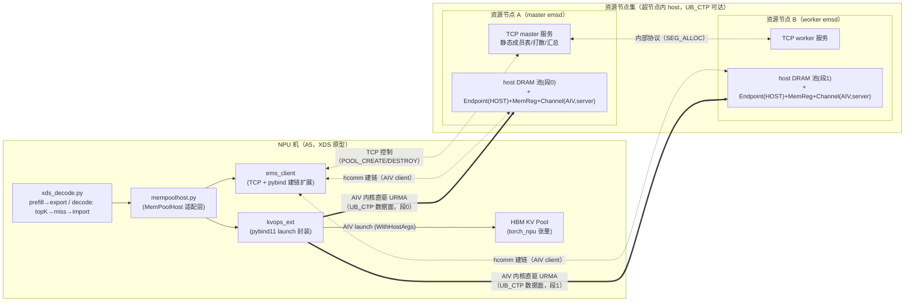
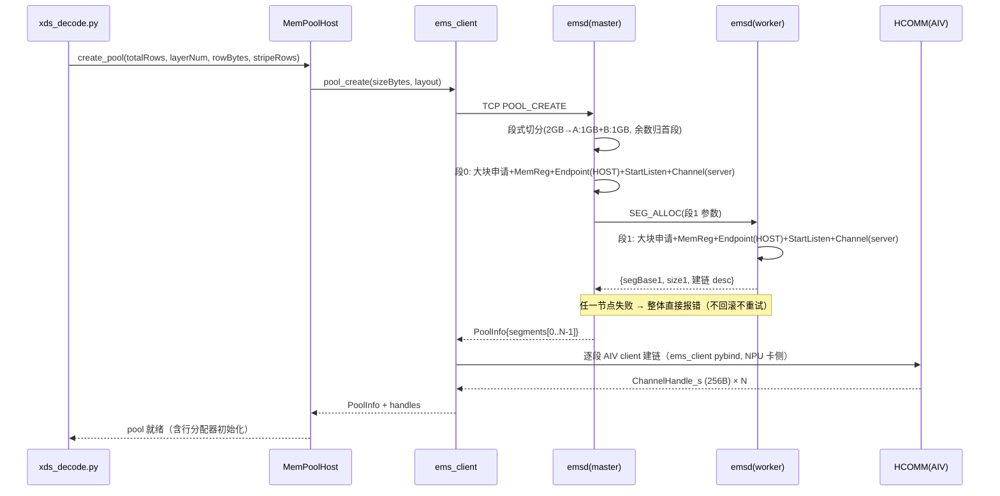
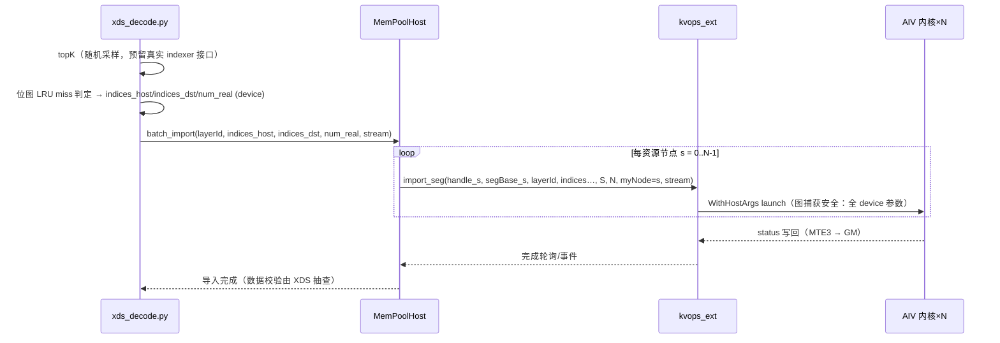

# XDS KV Cache AIV 直驱卸载 软件设计方案

版本：V1.1
作者：
日期：2026-11-06
评审人：SUNJIE

变更记录：

| 版本 | 日期 | 修改人 | 修改内容 |
| --- | --- | --- | --- |
| V1.0 | 2026-11-05 |  | 首次定稿：单仓三组件（ems/kvops/xds）、多资源节点、分配均衡打散到各节点、基于 HCOMM 的 AIV 直驱批量算子、图捕获两级验证 |
| V1.1 | 2026-11-06 |  | 见附录 A：miss 识别 device 化（SIEVE 哈希-only 移植）；导入算子稠密化；xds 三文件重组；构建/运行拆分 |

## 1. 概述

### 1.1 背景与目标

**背景**：DSA（DeepSeek Sparse Attention 类）模型 decode 阶段，注意力计算依赖 lightning indexer 产出的 topK token 集合，序列上下文远超 HBM 可驻留容量，需要将 KV cache 卸载到远端 Host DRAM。XDS 为内部推理框架（对标 sglang/vllm 调度形态），其 decode 路径为：lightning indexer 计算 topK → HBM 热缓冲查找 miss slots → 从远端内存批量读取回 HBM。

现有 NPU 参考路径（sglang hisparse NPU 实现）为 CPU 串行管线：topK 索引同步 D2H → CPU LRU 循环 → staging buffer 拷贝 → torch H2D → index_copy_，逐层串行且存在 host 同步点，难以进入图模式，层内批量带宽受 host CPU 搬运限制。

**已验证技术底座**（AIV+URMA 直驱 PoC，全量回归通过）：AscendC 内核以 fatbin 显式加载链（`aclrtBinaryLoadFromFile` LAZY_LOAD + `aclrtBinaryGetFunction` + `aclrtLaunchKernelWithHostArgs`，ENGINE_TYPE=AIV）直驱 HCOMM URMA 通道，读写对端注册内存全通；内核侧 status 写回采用 UB+DataCopy(MTE3) + c310 epilogue；参数采用扁平标量+8B overflow 尾槽 ABI。

**目标**：

1. 构建 XDS KV cache 卸载原型三组件：EMS（远端内存服务，多资源节点聚合）、kvops（AIV 直驱批量导入/导出算子）、XDS 适配层（MemPoolHost 单文件 + decode 流程驱动）。
2. 每层 KV cache 均衡分布到多个资源节点大块内存上，任意批量读写并发聚合 N 节点带宽（目标：2 节点聚合带宽 ≈ 2× 单节点）。
3. 批量导入/导出算子支持 aclrtGraph 流捕获（两级验证：ACLRT 原生 → torch_npu graph），capture/replay 无 host 同步。
4. 数据面正确性 100% 可校验（行级模式填充 + CRC）。

### 1.2 范围

**包含**：

- ems 组件：emsd 守护进程（C++，master/worker 主从、静态成员表、段式切分、host DRAM 池管理、host 侧 HCOMM 建链）+ ems_client（Python，含 pybind 建链扩展）。
- kvops 组件：AIV 内核（AscendC，fatbin）+ kvops_ext（pybind11 launch 封装，图捕获安全）。
- xds 组件：mempoolhost.py（单文件适配层）+ xds_decode.py（decode 流程驱动，含 topK 简化实现与 miss 判定，预留真实 indexer 接口）。
- 建链协议：跨节点 UBC（UB_CTP，host locType），协议参数化预留 UB_RTP(UBG)。
- 验证：V0-V5 验证矩阵（见第 8 章）。

**不包含**：

- 真实 lightning indexer 集成（接口预留，topK 用随机采样替代）。
- 多机 TP、跨机一致性协议。
- UBG 跨模式建链（资源节点要求与 NPU 机同 UBC 网络可达；UB_RTP 切换为 M4 预留项）。
- 生产级容错（失败直接报错，不回滚不重试）。
- 内存池去重/压缩/分层淘汰策略。

### 1.3 术语与缩略词

| 术语 | 说明 |
| --- | --- |
| XDS | 内部推理框架原型（Python，对标 sglang/vllm 调度形态），DSA 模型 decode 场景 |
| MemPoolHost | XDS 的 KV cache 卸载适配层（xds 组件内单文件），提供创建内存池/批量导出/批量导入 |
| EMS | 弹性内存管理服务：管理远端资源节点 Host DRAM，负责建链+大块内存申请 |
| emsd | EMS 守护进程（C++），部署于每个资源节点，分 master/worker 角色 |
| ems_client | EMS 框架侧客户端（Python），向主节点申请资源，返回远端内存地址+ChannelHandle |
| kvops | 批量算子组件：AIV 内核 + pybind11 launch 扩展 |
| AIV | Vector Core，NPU 向量核，本方案数据面执行体（内核直驱 URMA） |
| HCOMM | 昇腾集合通信库（libhcomm），提供 endpoint/channel/memreg 原语与 AIV 引擎通道 |
| UB_CTP | 超节点内 UBC 网络传输协议（本方案建链协议），host locType 支持资源节点 host 内存 |
| UB_RTP(UBG) | 跨 UBG 网关协议（=UBG），EID 路由+PSN，M4 预留切换项 |
| ChannelHandle | HCOMM 通道句柄（ChannelEntity，256B，ABI 稳定），作为算子入参直传 AIV 内核 |
| MLA | Multi-head Latent Attention：per-token 打包 K‖V 单行布局 |
| 行(row) | 一层一个 token 的 KV cache 存储单元（packed K‖V，~1.2KB） |
| topK / miss | indexer 选出的 token 位置 / 不在 HBM 热缓冲中、需从远端读取的行 |
| WQE / CQE | URMA 提交队列元素 / 完成队列元素 |
| fatbin | AscendC 内核二进制（显式加载链产物，保留原始符号名） |
| MTE3 | Memory Transfer Engine 3，内核侧 GM 写回通道（status 写回用） |
| 条带(stripe) | 行归属打散粒度参数 S：连续 S 行归属同一资源节点 |

## 2. 需求分析

### 2.1 功能需求

| 编号 | 需求 |
| --- | --- |
| FR1 | 资源申请：MemPoolHost 经 ems_client 向主 emsd 申请大块内存，主节点按段式连续切分打散到各资源节点，返回每段 {远端基地址, 大小, ChannelHandle} |
| FR2 | 建链：emsd（host 侧 server）与框架侧（NPU 卡侧 client）建立 HCOMM AIV 引擎通道；每资源节点一条独立通道 |
| FR3 | 批量导出：HBM KV cache 按行 gather → AIV 直驱 URMA 写远端内存（支持全层连续区间与单层少量行两种形态） |
| FR4 | 批量导入：按行号索引从远端内存 gather → AIV 直驱 URMA 读 + 写 HBM 指定行（间接寻址） |
| FR5 | 层维度均衡：任意一层的行空间均匀分布到全部资源节点大块上（映射与层无关） |
| FR6 | 图捕获：FR3/FR4 算子可在 aclrtGraph 流捕获区间内调用，replay 无 host 同步、无 CPU 索引往返 |
| FR7 | 行分配：MemPoolHost 维护框架侧行号分配器（free-list），EMS 只管大块生命周期 |
| FR8 | decode 流程驱动：xds_decode.py 完整驱动 prefill 导出 → decode 循环（topK → miss 判定 → 批量导入 → 校验） |

### 2.2 非功能需求

| 维度 | 指标 |
| --- | --- |
| 聚合带宽 | 2 资源节点单层批量导入带宽 ≈ 2× 单节点（≥1.8× 验收）；具体绝对值以 V4 实测基线为准 |
| 时延 | 批量导入（512 行/层，1.2KB/行）目标 < 单节点同规模 2 倍时延内完成 2× 数据量；图模式 launch 开销 < 逐次 launch 的 50% |
| 图模式 | capture/replay 数据正确性与非图路径一致；连续 replay ≥1000 次无泄漏 |
| 内存 | 资源节点大块池预分配（原型单池）；NPU 侧无 staging 中转（免 pinned buffer） |
| 可靠性 | 批量操作失败可检测（status 错误码）、可定位（行级错误码）；EMS 断连可感知 |
| 兼容性 | ChannelEntity ABI 256B 稳定；建链协议参数化（UB_CTP → UB_RTP 切换不改内核） |
| 观察项 | 逐行 WQE（~1.2KB）小包吞吐；对策见 4.3 与第 10 章 |

### 2.3 输入输出约束

- **KV 布局**：MLA packed K‖V per token：`rowBytes = (kv_lora_rank + qk_rope_head_dim) × dtypeSize`，典型 576×2B=1152B，按 128B 向上对齐（对齐增量计入行尾 padding，校验时跳过）。
- **行号语义**：行号为层内逻辑行号（每层独立行空间，同 token 各层行号同构）；HBM 侧行为物理槽位号（device buffer 行号），导入时 src/dst 双索引。
- **层布局**：
  - HBM 侧：`kvPool[layer][deviceRows]`（层连续），层基址由 XDS 提供。
  - 远端侧：每大块内 `[层0区][层1区]…[层L-1区]`，每层区 `perLayerSegRows = ceil(layerRows/N)` 行。
- **批量规模**：decode 导入 batch 上限 `maxBatch = numReq × topK`（典型 256×2048 行上限，实际 miss 子集）；prefill 导出为层内连续区间（`rowLo, rowCnt`）。
- **索引张量**：`indices_host(int64, device)`、`indices_dst(int64, device)`、`num_real(int32/int64 标量张量, device)`——全部驻留 device，host 不可见。

## 3. 总体方案

### 3.1 总体架构图



### 3.2 分层设计与模块划分

单仓多组件：

```text
proto_repo/
├─ ems/                              # EMS 组件 = 守护进程 + 框架侧客户端
│  ├─ emsd/                          # C++ 守护进程（每资源节点一个）
│  │  ├─ ctrl_server.cc              # TCP 控制服务（master: client 协议+worker 协议; worker: worker 协议）
│  │  ├─ pool_mgr.cc                 # 大块内存池（大页申请/释放）+ 段管理
│  │  ├─ hcomm_host.cc               # host 侧建链：dlsym hcommlib（EndpointCreate(HOST,UB_CTP)+StartListen+MemReg+ChannelCreate(AIV,server)）
│  │  └─ main.cc                     # 启动参数：--role=master|worker --master=ip:port --members=静态成员表 --pool-size
│  ├─ ems_client/                    # Python 包（框架侧）
│  │  ├─ client.py                   # TCP 协议客户端（纯 Python）
│  │  └─ hcomm_cli_ext.cpp           # pybind11：卡侧 AIV client 建链封装（dlsym hcommlib）
│  └─ proto/                         # 报文定义（client↔master、master↔worker 共用）
├─ kvops/                            # 批量算子组件
│  ├─ kernel/                        # AscendC AIV 内核（fatbin 产物）
│  │  ├─ kvc_gather_rows.cpp         # 导入：远端 gather → HBM 间接写（单层，索引批量）
│  │  ├─ kvc_scatter_rows_alllayer.cpp  # 导出：HBM gather → 远端写（全层连续区间，条带聚合）
│  │  └─ kvc_common.h                # WQE 构造/批提交/status 写回(MTE3)/c310 epilogue（复用 PoC 框架）
│  └─ kvops_ext/                     # pybind11 扩展（NPU 侧）
│     ├─ loader.cc                   # fatbin 显式加载链（LAZY_LOAD+GetFunction，PoC 方案 B）
│     ├─ launch.cc                   # launch 封装（args 扁平化+overflow 尾槽+三 attr cfg，stream 透传）
│     └─ bind.cc                     # Python 接口导出
└─ xds/                              # XDS 原型（Python）
   ├─ mempoolhost.py                 # MemPoolHost 适配层（单文件：create_pool/alloc/free/batch_export/batch_import）
   └─ xds_decode.py                  # decode 流程驱动（prefill 导出 → topK → miss → 批量导入 → 校验）
```

**语言分工**：内核=AscendC C++（fatbin）；emsd/建链扩展/launch 扩展=C++（pybind11）；ems_client 主体/MemPoolHost/XDS=Python。

### 3.3 核心流程

**建链+建池时序（POOL_CREATE）**：



**decode 导入时序（每步）**：



**导出**：prefill 结束全层导出（`batch_export(all_layers, rowLo=0, rowCnt=prefillLen)`，N 次 `export_seg` launch，内核内层循环+条带聚合）；decode 增量导出（单 token 单行，N 次单层 `export_seg`）。

**释放流程**：XDS 结束 → MemPoolHost.pool_destroy → ems_client TCP POOL_DESTROY → master 通知各 worker：ChannelDestroy → EndpointDestroy → MemUnreg → 大块释放。EMS 断连时按第 6 章异常处理。

## 4. 详细设计

### 4.1 核心数据结构

**PoolInfo（ems_client → MemPoolHost）**：

```c
struct SegmentInfo {
    uint32_t nodeId;            // 资源节点编号（静态成员表序号）
    uint64_t segBase;           // 远端大块基地址（远端虚拟地址，MemReg 后 URMA 可达）
    uint64_t sizeBytes;         // 段大小
    uint8_t  channelHandle[256];// ChannelEntity（ABI 稳定，opaque 透传内核）
};
struct PoolInfo {
    uint32_t poolId;
    uint32_t nodeNum;           // N = segments 数量
    uint32_t layerNum;          // L
    uint32_t layerRows;         // 每层逻辑行数（全局行号空间容量）
    uint32_t perLayerSegRows;   // = ceil(layerRows / N)
    uint32_t rowBytes;          // 128B 对齐后行字节数
    uint32_t stripeRows;        // S（条带行数，默认 1）
    SegmentInfo segments[MAX_SEG_NUM];
};
```

**行归属映射（层维度均衡，映射与层无关）**：

```text
node(row)     = (row / S) % N                     // 任意层独立均衡：层内行均匀散到 N 段
segRow(row)   = (row / S) / N                     // 段内层内行号（紧凑，无空洞）
addr(l, row)  = segments[node].segBase
              + ( l * perLayerSegRows + segRow(row) ) * rowBytes
                └── 大块内布局：[层0区][层1区]…[层L-1区]，每层区 perLayerSegRows 行 ──┘
```

均衡性：S=1 时任意层的任意行集合按 `row % N` 严格均分到 N 节点；单层导入/全层导出均并发打满 N 节点带宽。

**框架侧行分配器（MemPoolHost 内）**：free-list（区间合并的简单链表或位图）+ 已分配计数；`alloc(n) → 行号区间/列表`、`free(rows)`；与 sglang `HostKVCache.alloc/free` 语义对齐。行号即 token 的 host 池逻辑索引（各层同构）。

**status 布局（内核写回，MTE3）**：

```text
status（GM，每 launch 实例独立 8B 槽）:
  [0..3]  uint32_t errCode     // 0=成功；行级错误码：0x1000+i（第 i 个 WQE 失败）、0x2000+op（URMA op 失败）
  [4..7]  uint32_t doneSeq     // 完成序号（launch 实例号，防串扰）
```

**索引张量（全部 device 驻留）**：`indices_host[int64, maxBatch]`（host 池逻辑行号）、`indices_dst[int64, maxBatch]`（HBM 物理槽位号，与 indices_host 一一对应）、`num_real[int64 标量]`（有效行数，图 padding 早退）。

### 4.2 接口设计

#### 4.2.1 emsd TCP 控制协议（client↔master、master↔worker）

报文格式：`Header{magic(4B)=0x454D5350, cmd(2B), payloadLen(4B), reserved(2B)} + JSON payload + 二进制尾随段（ChannelHandle 等定长字段）`。字符编码 UTF-8。

| cmd | 方向 | payload（JSON 字段） | 返回 |
| --- | --- | --- | --- |
| `POOL_CREATE` | client→master | sizeBytes, layerNum, layerRows, rowBytes, stripeRows | PoolInfo 序列化（JSON + 每段 256B handle 尾随） |
| `POOL_DESTROY` | client→master | poolId | status |
| `POOL_QUERY` | client→master | poolId | PoolInfo（不含 handle 重建语义） |
| `PING` | 双向 | — | pong |
| `SEG_ALLOC` | master→worker | segSizeBytes, layerNum, perLayerSegRows, rowBytes, listenPort, channelTag | segBase + handle(256B) + status |
| `SEG_FREE` | master→worker | poolId, segIndex | status |

语义：同步阻塞（原型）；POOL_CREATE 期间 master 顺序完成自身段与各 worker 段的「申请+MemReg+建链 server 就绪」，任一失败立即返回错误（**不回滚、不重试**，已成功段随 POOL_DESTROY 或 emsd 退出清理）。

#### 4.2.2 ems_client（Python）

```python
class EmsClient:
    def __init__(self, master_endpoint: tuple[str, int]): ...
    def connect(self) -> None: ...                    # TCP 建连 + 握手（版本协商，原型固定 V1）
    def pool_create(self, size_bytes: int, layer_num: int, layer_rows: int,
                    row_bytes: int, stripe_rows: int = 1) -> PoolInfo: ...
    def pool_destroy(self, pool_id: int) -> None: ...
    def connect_channels(self, pool: PoolInfo, device_id: int) -> list[bytes]:
        """逐段发起卡侧 AIV client 建链（hcomm_cli_ext），返回 ChannelHandle 列表（写入 pool.segments）"""
    def close(self) -> None: ...
```

hcomm_cli_ext（pybind11，卡侧）：`hcomm_client_connect(deviceId, serverIp, listenPort, channelTag, tokenId) -> bytes(256)`（内部 dlsym：SetDevice→HcommInit→EndpointCreate(DEVICE, UB_CTP)→MemReg(免，数据面单边)→ChannelCreate(AIV, client)→取 ChannelEntity）；`hcomm_client_disconnect(handle)`。

#### 4.2.3 kvops_ext（pybind11，NPU 侧）

```python
kvops.init(device_id: int, fatbin_path: str) -> int            # ctx（fatbin 加载链，进程一次）
kvops.export_seg(ctx, channel_handle: bytes, seg_base: int, layer_num: int,
                 per_layer_seg_rows: int, row_bytes: int,
                 src_layer0_base: int, src_layer_stride: int, src_row_stride: int,
                 row_lo: int, row_cnt: int, stripe_rows: int, node_num: int,
                 my_node: int, status_addr: int, stream: int) -> None
    # 全层导出（HBM → 远端段）：src 行 = row_lo..row_lo+row_cnt-1（各层同区间）
kvops.export_rows(ctx, channel_handle: bytes, seg_base: int, layer_id: int,
                  per_layer_seg_rows: int, row_bytes: int,
                  src_layer_base: int, indices_host_addr: int, indices_dst_unused: int,
                  num_real_addr: int, stripe_rows: int, node_num: int, my_node: int,
                  status_addr: int, stream: int) -> None
    # 单层索引导出（decode 增量）：远端写地址由 indices_host 经映射函数计算
kvops.import_seg(ctx, channel_handle: bytes, seg_base: int, layer_id: int,
                 per_layer_seg_rows: int, row_bytes: int, dst_layer_base: int,
                 indices_host_addr: int, indices_dst_addr: int, num_real_addr: int,
                 stripe_rows: int, node_num: int, my_node: int,
                 status_addr: int, stream: int) -> None
    # 单层索引导入（decode miss 回取）：src=远端(indices_host 映射), dst=HBM(indices_dst 间接)
kvops.alloc_status(ctx, count: int) -> int                      # status 槽数组 GM 地址
kvops.poll_status(ctx, status_addr: int, done_seq: int, timeout_us: int) -> int
kvops.run_graph / capture 辅助由 torch_npu graph 外层驱动，本扩展保证 launch 可捕获
```

说明：`*_addr` 参数均为 device 侧地址（`tensor.data_ptr()`），扩展内部不读内容（capture 安全）；`stream=0` 表示默认流，capture 时由调用方传入 torch_npu 当前流。

#### 4.2.4 MemPoolHost（mempoolhost.py，单文件）

```python
class MemPoolHost:
    def __init__(self, ems: EmsClient, device_id: int,
                 layer_num: int, layer_rows: int, row_bytes: int,
                 kv_lora_rank: int, qk_rope_head_dim: int, stripe_rows: int = 1): ...
    def create_pool(self, total_rows: int) -> None          # ems.pool_create + connect_channels
    def alloc(self, n: int) -> list[int]                    # 框架侧行号分配（free-list）
    def free(self, rows: list[int]) -> None
    def batch_export(self, hbm_kv_pool, row_lo: int, row_cnt: int,
                     stream=None) -> None                   # 全层连续区间导出（prefill）
    def batch_export_rows(self, hbm_kv_pool, layer_id: int,
                          indices_host, stream=None) -> None    # 单层少行导出（decode 增量）
    def batch_import(self, hbm_kv_pool, layer_id: int,
                     indices_host, indices_dst, num_real, stream=None) -> None
        # decode 导入：内部对 segments 循环 import_seg（N 次 launch，共享 indices）
    def wait(self, timeout_us: int = -1) -> int             # status 轮询聚合
    def destroy(self) -> None
```

图捕获约定：`batch_import/batch_export*` 可在 torch_npu graph capture 区间内调用；内部仅发起 launch（无 D2H/H2D 同步、无 host 读 device 内存）；`num_real` 标量张量早退法保证 padding 图多批次重放正确。

#### 4.2.5 AIV 内核签名（AscendC，fatbin）

```cpp
// 导入：单层索引批量（每资源节点一次 launch，共享 indices，过滤本节点行）
__global__ __aicore__ void kvc_gather_rows(
    GM_ADDR channelEntity,          // 本节点 ChannelEntity（256B，kernel 参数）
    uint64_t segBase,               // segments[myNode].segBase
    uint32_t layerOffsetRows,       // layer_id * perLayerSegRows
    uint32_t perLayerSegRows,
    uint32_t rowBytes,
    GM_ADDR indicesHost,            // int64[] host 池逻辑行号（共享）
    GM_ADDR indicesDst,             // int64[] HBM 物理槽位号（共享）
    GM_ADDR numReal,                // 标量张量：有效行数（图 padding 早退）
    uint32_t stripeRows,            // S
    uint32_t nodeNum,               // N
    uint32_t myNode,                // s：过滤 (row / S) % N == s
    GM_ADDR dstLayerBase,           // HBM 层基址（dst 间接寻址）
    GM_ADDR status);                // MTE3 写回

// 导出：全层连续区间（prefill，条带聚合大 WQE）
__global__ __aicore__ void kvc_scatter_rows_alllayer(
    GM_ADDR channelEntity, uint64_t segBase,
    uint32_t perLayerSegRows, uint32_t rowBytes,
    uint32_t rowLo, uint32_t rowCnt,        // 各层同区间
    uint32_t layerNum,
    GM_ADDR srcLayer0Base,                  // HBM 层 0 基址
    uint64_t srcLayerStride,                // HBM 层跨距（字节）
    uint32_t stripeRows, uint32_t nodeNum, uint32_t myNode,
    GM_ADDR status);

// 导出：单层索引批量（decode 增量，形态同 gather 方向相反）
__global__ __aicore__ void kvc_scatter_rows(
    /* 参数同 kvc_gather_rows，数据方向 HBM → 远端 */);
```

launch 链（PoC 方案 B，已验证）：`aclrtBinaryLoadFromFile(fatbin, {LAZY_LOAD,1})` → `aclrtBinaryGetFunction("原名")` → `aclrtLaunchKernelWithHostArgs(func, blockDim, stream, cfg, args, argsSize, nullptr, 0)`；cfg 三 attr = `SCHEM_MODE=1 + TIMEOUT_US + ENGINE_TYPE=AIV`；args 扁平标量+8B overflow 尾槽。blockDim/rowsPerCore 切分策略复用 PoC 批提交框架（64KB 块粒度、VECOUT 管线）。

### 4.3 关键算法 / 逻辑

**（1）内核过滤式分组（免 host 索引拆分）**：`kvc_gather_rows` 遍历 `indicesHost[0..numReal)`，仅处理 `(row/S)%N == myNode` 的行——N 个节点内核实例共享同一份 indices，各自过滤子集；无需 host 侧按节点拆分索引（避免 D2H 同步，图捕获安全）；过滤扫描开销可忽略（indices 仅数十 KB）。

**（2）条带聚合提交（导出性能）**：`kvc_scatter_rows_alllayer` 对本节点行区间（`segRow` 连续）按条带探测连续段：连续 ≥ stripeRows×N 行的区间在段内偏移连续（`segRow=(row/S)/N` 等差），聚合为单次大 WQE（S=64 时约 64×1.2KB≈76.8KB，匹配 PoC 实测最优 64KB 块量级）；散行回退逐行 WQE（导入路径天然散行，逐行基线）。

**（3）批提交与完成跟踪**：复用 PoC 队列深度/VECOUT 批提交框架；WQE 提交后内核**不自旋等待** CQE——完成语义由两层构成：URMA 完成走 PollCq「先拷贝后判断」修正姿势（对齐 RoCE 版实现，规避 asc-devkit hcomm_aiv_urma.h 的 check-before-copy 缺陷）；launch 级完成走 status（MTE3 写回 doneSeq+errCode），host 侧 `poll_status` 轮询或 stream event 兜底。

**（4）num_real 图 padding 早退**：capture 时按 `maxBatch` 录制，replay 时 `num_real` 标量张量由框架更新（图外小写入），内核前缀比较 `i < numReal` 早退——与 sglang `num_real_reqs` 同法。

**（5）行分配器**：原型用位图+首次适应区间扫描（`layerRows ≤ 数百万` 量级，alloc/free 低频）；`alloc(n)` 返回连续区间优先（利于导出条带聚合），不足时拼接离散行。

## 5. 通信与资源模型

### 5.1 通信通路与协议选型

| 通路 | 协议 | 用途 |
| --- | --- | --- |
| ems_client ↔ emsd(master) | TCP（自定义 TLV+JSON） | 池申请/销毁/查询 |
| emsd(master) ↔ emsd(worker) | TCP（SEG_ALLOC/SEG_FREE） | 段分配下发 |
| 框架侧 ↔ 资源节点（建链期） | HCOMM OOB socket（rasocket）+ AivUrmaTransport 交换 | 换取 token/jetty/seg key（ChannelHandle 生成） |
| 数据面（运行期） | URMA over UB_CTP（AIV 内核直驱 WQE） | KV 行批量读写，payload 不过任何 CPU |

选型依据：控制面 TCP 简单可控且跨平台；数据面 UB_CTP 为超节点内 UBC 网络原生协议（PoC 已验证），协议在 endpoint/channel 描述中参数化，切 UB_RTP 仅改建链参数（EMS 与内核均零改动，M4 验证）。

### 5.2 控制面、数据面分离

- 控制面（TCP + 建链 OOB）：低频、建池/建链/销毁期一次完成；ChannelHandle 生成后控制面不再参与数据传输。
- 数据面（AIV 内核 + URMA）：高频、每次批量导入/导出仅发起 launch（N 次）+ status 轮询；capture 后 replay 连 launch 调用都省略。
- 解耦点：`PoolInfo + ChannelHandle` 是两面的唯一交割物——控制面产出、数据面消费（kernel 参数）。

### 5.3 资源生命周期管理

| 资源 | 创建 | 使用 | 销毁 |
| --- | --- | --- | --- |
| pool（EMS 侧） | POOL_CREATE | 段管理元数据 | POOL_DESTROY / emsd 退出扫尾 |
| segment（大块） | SEG_ALLOC：大页申请+MemReg | 数据面寻址 | SEG_FREE：MemUnreg+大页释放 |
| channel | 建链期（server: emsd / client: 框架侧） | ChannelHandle 传内核 | ChannelDestroy→EndpointDestroy（两侧） |
| ChannelHandle | 建链完成 | kernel 参数（图内固化，建链必须在 capture 前） | 随 channel |
| status 槽 | `alloc_status(count)` | launch 实例写回/poll | 随 ctx 释放 |
| 行号（框架侧） | MemPoolHost.alloc | 索引张量内容 | MemPoolHost.free（延迟语义：import 完成后方可 free 复用，由 XDS 按 wait 保证） |

顺序约束：建链完成 → capture；池销毁 → 全部 launch 完成 + graph 释放。

## 6. 异常与容错设计

| 场景 | 检测 | 处理 |
| --- | --- | --- |
| 资源节点分配/建链失败（POOL_CREATE 期） | SEG_ALLOC 返回错误码 / 建链超时 | master 直接向 ems_client 返回失败（**不回滚不重试**，原型语义）；已成功段由 POOL_DESTROY 或 emsd 退出清理 |
| EMS TCP 断连（运行期） | TCP RST/心跳超时 | ems_client 抛异常；运行中数据面不中断（已建通道自治），池销毁受阻时 emsd 侧扫尾（空闲超时回收） |
| 单节点数据面失败（WQE/CQE 错误） | status errCode（0x1000+i / 0x2000+op） | launch 级报错上抛 XDS；XDS 可选择重试该批次（重发同 indices） |
| 批量超时 | poll_status timeout | 报错 + 通道健康检查（PING 级探测），异常通道标记不可用 |
| 非法行号（row ≥ layerRows / dst 越界） | 内核侧过滤自然跳过 + 可选 debug 校验模式（越界计数写 status） | debug 模式报错；release 模式越界行忽略（信任框架索引） |
| 大块 OOM | SEG_ALLOC 失败 | 直接报错（含节点 id 与请求/可用容量，日志定位） |
| 图 replay 期间资源销毁 | 生命周期顺序约束（5.3） | 文档化约束 + MemPoolHost.destroy 断言 graph 已释放 |
| emsd 进程退出 | TCP 断连 | 同断连处理；下次 POOL_CREATE 失败（资源不可得） |

日志规范：失败路径 ERROR 日志包含错误描述、poolId/nodeId/segIndex、外部接口名（HcommChannelCreate 等）、返回码与关键参数（segSizeBytes、rowBytes 等）；数据面高频路径不刷 INFO（性能）。

## 7. 并发 & 同步设计

| 点 | 设计 |
| --- | --- |
| 多 stream 并发导入/导出 | 每 launch 实例独立 status 槽（doneSeq 防串扰）；不同 stream 可并发发起（URMA 通道 SQ 深度共享，由批提交框架的队列深度控制串行化） |
| 图模式与即时模式混跑 | status 槽按 ctx 分配独占；capture 与即时 launch 不共享槽 |
| 内核侧可见性 | status 写回走 UB→MTE3（DataCopy）+ c310 epilogue（pipe_barrier/dsb/dci），保证 host 可见（PoC 已验证 volatile 直写不可见问题） |
| host 侧完成等待 | poll_status 轮询（带 usleep 退避）或 stream event；禁止内核内自旋等 CQE |
| EMS 并发 | 原型 emsd 单线程 Reactor（池操作低频）；TCP 无锁；建链阻塞段串行 |
| Python GIL | kvops_ext / hcomm_cli_ext 的阻塞调用（poll/建链）释放 GIL（pybind11 `py::call_guard<py::gil_scoped_release>`） |
| 行分配器 | Python 侧单线程持有（XDS 调度线程独占），无锁 |

## 8. 测试方案

| 编号 | 类别 | 内容 | 通过标准 |
| --- | --- | --- | --- |
| V0 | 建链 | ≥2 资源节点 UB_CTP host 建链（emsd server × N + 框架侧 client）；POOL_CREATE/DESTROY 全流程；失败注入（停一个 worker emsd 再建池） | 建链成功率 100%；失败场景报错信息含节点定位；**前置依赖：若触发跨模式 socket（HDC↔PEER）异步 connect 问题，按预案启用同步化修改（约 30-50 行，卡侧建链封装内）** |
| V1 | 图捕获 | 两级：①ACLRT 原生 stream capture（pybind 侧 aclrtGraph API）单算子 capture→replay；②torch_npu graph（框架实际用法）batch_import capture/replay | replay 数据正确性与非图一致；连续 replay ≥1000 次无泄漏无错；num_real 变化重放正确 |
| V2 | 批量正确性 | 行数 {1, 16, 256, 4096} × {单层导入/全层导出/单层导出} × N∈{1,2}；行模式填充（行号+层号指纹）+ 逐行校验（含 padding 跳过） | 数据 100% 一致；越界/非法行 debug 模式检出 |
| V3 | XDS 全流程 | xds_decode.py：prefill 导出（多请求）→ decode 循环（topK 随机采样 → 位图 LRU miss → 批量导入 → 校验）→ 行回收复用 | 端到端零差错；行分配器无泄漏（alloc/free 平衡断言） |
| V4 | 性能 | ①单层导入 N=1 vs N=2 带宽比（目标 ≥1.8×）；②每层行分布均衡性（各层各节点行数方差 ≈ 0）；③批次规模-时延曲线（16..4096 行）；④图模式 vs 逐次 launch 开销；⑤逐行 WQE 小包吞吐观察（对比条带聚合导出） | 出基线报告；①达成聚合目标 |
| V5 | 异常注入 | TCP 断连（kill emsd）、建链超时、非法行号、status 超时、double free 行号 | 报错路径全覆盖、日志可定位（含关键参数）、无崩溃无挂死 |

单测补充：映射函数（node/segRow/addr）参数化单测（N/S/layerRows 边界、余数行）；行分配器单测（碎片化后分配/合并）；TCP 协议编解码单测。

## 9. 依赖与环境

| 项 | 要求 |
| --- | --- |
| NPU 机 | A5（Ascend 950PR/DT，dav-3510），CANN 9.1.0（cann 组件含 libhcomm.so）；Ubuntu 22.04 aarch64 |
| 资源节点 | 超节点内与 NPU 机 UBC 网络互通的 host 通用服务器；UB_CTP host locType 支持（hcommlib noDevice 形态：HCOMM_FORCE_NODEVICE=1 构建 + liburma 运行环境） |
| Python | ≥3.8；torch + torch_npu（图捕获用 torch_npu graph） |
| C++ 工具链 | GCC ≥11.4；pybind11 ≥2.10；CMake ≥3.12 |
| 内核构建 | AscendC fatbin 工具链（ascendc_fatbin_library，朴素 `__global__ __aicore__` 声明，禁止核型属性宏） |
| hcommlib 接入 | dlsym 显式加载（与 MemFabric 同构），不引入 hccl 依赖 |
| 验证辅助 | 行指纹校验工具（Python）；带宽统计脚本 |

## 10. 风险与对策

| 风险 | 等级 | 影响 | 对策 |
| --- | --- | --- | --- |
| ACLRT 对 AIV 引擎 launch（WithHostArgs）的流捕获支持度未验证 | **高** | 图模式目标受阻 | V1 前置最早验证；备选①改用 ACLRT_LAUNCH_KERNEL 宏形态（kv_ops_opt 先例）；备选②静态 shape 整图下发（牺牲 num_real 动态性，batch 定长） |
| 资源节点 host 与 NPU 卡建链触发跨模式 socket 问题（HDC↔PEER 异步 connect 事件不回传） | 高 | V0 建链失败 | 已知根因与修复模式（同步 connect + GetStatus 阻塞轮询，约 30-50 行，改在卡侧建链封装内）；probe 全套方案作最后兜底 |
| 逐行 WQE（~1.2KB）小包吞吐不足（导入路径） | 中 | 导入带宽低于预期 | 观察项（V4-⑤）；对策：多 sge 聚合（hcomm WQE 原生支持）、导入侧条带化布局调整 |
| 卡侧 CANN 组件 libhcomm 与资源节点 noDevice 构建 ABI/枚举差异（UB_CTP host 路径） | 中 | 建链或运行失败 | V0 先行验证；必要时 NPU 机侧换用与资源节点同基线构建（ChannelEntity ABI 两基线一致，已核实） |
| UB_RTP(UBG) 模板上兼容性（M4 切换期） | 中 | 切换受阻 | 通道工厂同通道类（AivUrmaChannel），内核 Hcomm 模板同一设备面，预期零改动；M4 实测 |
| 行分配碎片化导致导出条带聚合退化 | 低 | 导出性能缓降 | alloc 连续区间优先；V3 断言碎片率；必要时整理（compact）预留接口 |
| EMS 单点（master）故障 | 低 | 池管理不可用（数据面已建通道不受影响） | 原型接受；生产化时 worker 提升主节点（超出本期范围） |

## 11. 工作量 & 排期

| 阶段 | 内容 | 出口标准 | 工期（估） |
| --- | --- | --- | --- |
| M1 | emsd（master/worker/池/建链 server）+ ems_client（TCP+pybind client 建链）+ kvops 单算子（gather/scatter 非图路径） | V0 全过 + V2 行数 {1,16,256} 通过 | 1.5 周 |
| M2 | 图捕获两级验证（ACLRT 原生 → torch_npu graph）+ num_real 早退 + status 语义完善 | V1 全过（含 1000 次 replay） | 1 周 |
| M3 | mempoolhost.py + xds_decode.py 集成；条带聚合优化；性能基线 | V3 + V4 全过（含 2 节点带宽 ≥1.8×） | 1 周 |
| M4（预留） | UB_RTP(UBG) 跨模式切换验证（建链参数切换 + 回归 V0-V4） | 切换后矩阵复测通过 | 1 周（视 UBG 环境就绪） |

里程碑依赖：V0 中的跨模式 socket 预案与 V1 图捕获为两个最高风险前置项，安排在 M1/M2 最前段执行以尽早暴露。

## 附录 A：V1.1 修订（miss 识别 device 化与工程重组）

### A.1 miss 识别 device 化（SIEVE 算子，移植自 sglang-0730）

原 V1.0 中 miss 判定为框架侧 CPU 扫描（Python 集合/位图）。V1.1 移植 sglang-0730 hisparse 的 SIEVE 内核，按以下裁剪落地为本仓算子：

| 项 | 决策 |
| --- | --- |
| 算法 | SIEVE（FIFO 环形 + visited 位 + hand 指针，摊还 O(1)）；LRU 变体不移植 |
| 哈希模式 | 仅保留开放寻址哈希（Knuth 乘法散列 + 线性探测 + backward-shift 删除，无 tombstone）；直接索引位图模式去除——ht 容量与上下文长度解耦（2 的幂 >= 2x(padded+topK)，装载因子 <=0.5） |
| visited 存储 | 位图化（uint8 packed bit，/8 HBM 与 UB 占用）；访问经读-改-写单字节 |
| 正确性约束族（照搬） | padded%16==0、padded<=65534（uint16 槽号）、visited 位图行 64B 对齐、hand 行距 16xint32（64B cache line，防跨 block 标量 store 互踩）、reqsPerCore 对齐 64/gcd(topK,64)、UB 预算 <=176KB/核 |
| 输出契约 | 稠密 top_k_device_slots/is_miss [maxNumReqs, topK]，全行重写 + (-1) 哨兵（调用方免修正趟，图 replay padding 行安全） |
| 新内核 | hisp_sieve_update（逐层切片状态更新）、hisp_sieve_ht_init（admission 恒等布局建表） |

### A.2 批量导入算子稠密化（kvc_gather_rows v2）

导入算子输入由压缩行列表（indices_host/indices_dst）改为直接消费 sieve 稠密输出：

扫描 [numReal x topK)：isMiss==1 且 (row/S)%N == myNode 才搬运；
src 行号 = reqHostBase[bid] + tokenPos（行分配连续性契约，免 req_to_host_pool 大表）；
dst 行号 = hotRowBase + slot（热缓冲槽固定偏移契约，免 req_to_device_buffer 大表）；
多 block 按 positions 分片（每 block 独立 Hcomm 实例/WQE 流水，status 按 block 分片 <=8）。

压缩版 kvc_scatter_rows（单层索引导出）删除；全层区间导出 kvc_scatter_rows_alllayer 不变。

### A.3 xds 组件重组（三分文件）

xds/
- xds_decode.py    主程序入口（参数化：--req-num/--miss-ratio/--topk/...；--oracle CPU 对拍；--run-dir 日志）
- xds_offload.py   XdsOffloadCoordinator：SIEVE 状态张量（按层持久）/admission/每步 sieve_update
- xds_ems_pool.py  EmsPool（替换 mempoolhost.py）：init/alloc_rows/free_rows/batch_read(稠密)/batch_write_alllayers

SIEVE 状态张量（HBM 预算优先；pool=请求槽位，按层 [L, pool, ...]）：

| 张量 | 形状/dtype | 优化点 |
| --- | --- | --- |
| device_buffer_tokens | [L,pool,padded] int32 | 保留（ht_erase 反查必需；ctx>64k 不可压位宽） |
| device_buffer_visited | [L,pool,ceil(padded/8) 上取 64B] uint8 位图 | /8（原 uint8/槽） |
| device_buffer_ht | [L,pool,2^k>=2(padded+topK)] uint16 | 哈希-only（与 ctx 长度解耦） |
| sieve_hand | [L,pool,16] int32 | 保留 64B 行距（正确性约束） |
| req_host_base | [maxNumReqs] int64 | 压缩（替代 req_to_host_pool [reqs,ctx]，200MB 级降到 KB 级） |

### A.4 构建/运行拆分

- 构建统一入口 build.sh [emsd|kernel|ext|all]（资源节点仅需 emsd；NPU 机 ext+kernel）。
- 运行即两个现成入口：资源节点 emsd（master/worker）；计算节点 python -m xds.xds_decode。
- README 对齐 memfabric 14 号示例结构（快速开始/参数表/验收标准/排障表）；xds_decode 支持 --run-dir（默认 ./log，每次截断重写）。

### A.5 验证矩阵增补

| 编号 | 内容 |
| --- | --- |
| V2' | 稠密导入对拍：--oracle 模式 CPU sieve 模型逐层校验 slots/is_miss（second_chance/ht_churn/重复 token 用例已入单测） |
| V6 | SIEVE 内核规模场景（参考 test_hisparse_lru_npu.py：reqs 1..256 x topK x blockDim 扫描）留 M2 图捕获一并回归 |
